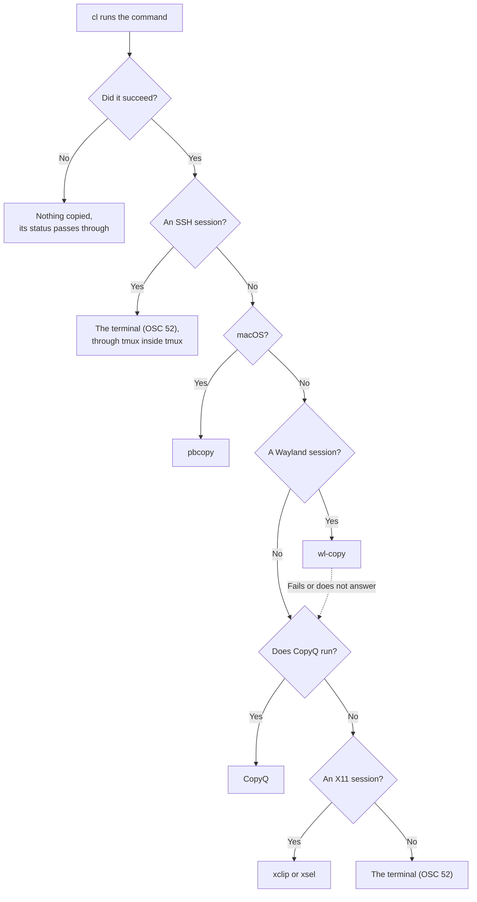

<!-- Author: Dr. Denys Dutykh (Mathematics Department, Khalifa University of Science and Technology, Abu Dhabi, UAE). -->

# cl

A path, a commit, the version of a program, the result of a computation: what a command prints is very often the next thing one wants to paste, into an email, a note, a form or another terminal. The command `cl` puts it there. Written in front of any command, it runs that command as usual and, when the command succeeds, puts what it printed on the clipboard, ready for Ctrl+V:

```text
$ cl realpath notes.txt
/home/you/papers/notes.txt
✓ copied 1 line, 26 characters
```

Nothing else changes. The output appears as it comes and reaches the next program of a pipeline unchanged; the copy leaves out the final newline, so that a pasted path does not run as a command, and the colour codes, so that a pasted text is plain. A command that fails copies nothing: the clipboard keeps what it had, cl says why, and the exit status of the command passes through, so that `cl cmd && next` behaves as `cmd && next` would.

The program is one bash file. It needs bash 3.2 or newer and runs on Linux and macOS. It reaches the clipboard through wl-copy (from wl-clipboard) in a Wayland session, CopyQ when it runs, xclip or xsel in an X11 session, pbcopy on macOS, and from an SSH session through the terminal itself, which hands the copy to the clipboard of the machine where its window is. Perl, present on nearly every system, keeps a picture off the screen while it is copied.

The repository is at

https://github.com/dutykh/cl

## Install

A clone with a link keeps the command up to date with a `git pull`:

```bash
git clone https://github.com/dutykh/cl ~/workspace/cl
~/workspace/cl/install.sh --link
```

The installer puts `cl` in `~/.local/bin` (a copy, or with `--link` a link to the clone) and writes its completion for bash and zsh. Without a clone, one line does the same with a copy:

```bash
curl -fsSL https://raw.githubusercontent.com/dutykh/cl/main/install.sh | bash
```

On Ubuntu, `sudo apt install wl-clipboard` provides wl-copy if it is missing, and `sudo apt install copyq` adds the clipboard manager CopyQ, which cl uses when it runs. The shell additions described below take one more line in `~/.bashrc`, and `install.sh --uninstall` removes the command and its completions.

## Everyday use

Any command can stand after `cl`, with its arguments exactly as they would be written without it. Here the commit of a repository goes to the clipboard, a search that finds nothing leaves the clipboard alone, and a list of files arrives through a pipe and is joined into one line:

```text
$ cl git rev-parse HEAD
4f1c0e2b9d7a5e3c1f0b8a6d4e2c0a9b7d5f3e1c
✓ copied 1 line, 40 characters

$ cl grep -n 'Theorem 3' paper.typ
✗ nothing copied: grep stopped with status 1

$ ls *.pdf | cl -j ', '
draft.pdf
paper.pdf
slides.pdf
✓ copied 1 line, 32 characters
```

The line that says what was copied goes to the terminal only, on the error stream, so a script that runs cl sees nothing more than the output of its command; `-q` silences it, and `-s` hides the output itself and shows its first characters in the confirmation instead. Bash itself offers `cl !!`, which runs the previous command again and copies what it prints. The option `-o` prints what the clipboard holds, `--clear` empties it, and `-p` uses the primary selection, the one that the middle button of the mouse pastes, instead of the clipboard. With `-a` the output of a failing command is copied all the same, its status kept, and with `-e` its error stream goes along, so that `cl -ae make` puts a whole error report on the clipboard, ready to send to a colleague.

## For emails, notes and the terminal

Four options shape the text before it is copied. The option `-c` puts the command line before its output, and `-m` wraps the result in a Markdown code block, which GitHub, Obsidian and Telegram show as code and which is also a valid raw block of Typst:

```text
$ cl -cm julia --version
julia version 1.13.4
✓ copied 4 lines, 53 characters
```

The clipboard then holds

````text
```console
$ julia --version
julia version 1.13.4
```
````

When the text itself holds three backticks, the fence grows to four, and so on. The option `-Q` quotes every line that needs it for the shell, so that paths with spaces can be pasted into a terminal, and `-j SEP` joins the lines with the separator: `cl -Q -j ' ' realpath "My Papers"/*.pdf` copies `'/home/you/My Papers/draft.pdf' '/home/you/My Papers/talk.pdf'` as one line.

## Files and pictures

The option `-f` puts files themselves on the clipboard, to be pasted into a file manager or attached to a message. When CopyQ runs, the files are offered in the three forms that GNOME Files itself offers when it copies files (a list of `file://` addresses, its own form, and the plain paths), so that a program which accepts files copied in GNOME Files accepts these; without CopyQ, wl-copy and xclip offer the list of addresses alone, which is the form most programs read. One picture named alone goes as the picture:

```text
$ cl -f figure.png
✓ copied the picture figure.png (PNG, 1240 x 1754, 312 KB)

$ cl -f paper.pdf supplement.pdf
✓ copied 2 files: paper.pdf, supplement.pdf
```

A command whose output is not text is handled the same way: its bytes are copied untouched with their type, and they are kept off the terminal, where they would only print noise. The page of a PDF file becomes a picture to paste into a message with

```text
$ cl pdftoppm -png -r 150 -f 3 -l 3 paper.pdf
✓ copied a picture (PNG, 1240 x 1754, 312 KB)
```

## Secrets

The option `-S` copies a secret, a token or a password, for a short while. The text is never shown, on the terminal or in the confirmation; when CopyQ runs, the copy carries the mark that tells clipboard managers to keep it out of their history; and a job left in the background clears the clipboard after 45 seconds if it still holds the secret, which it checks by a checksum, so that something copied in the meantime is left alone. The option `--clear-after SEC` changes the delay, and works for any copy.

```text
$ cl -S cat ~/.config/service/token
✓ copied a secret of 1 line; the clipboard is cleared in 45 s if it still holds it, and CopyQ keeps it out of its history
```

Through the terminal of an SSH session, the clipboard cannot be read back, so it is emptied after the delay whatever it then holds, and cl says so.

## Aliases, functions and the copy key

A program cannot see the aliases and functions of the shell that started it, so `cl ll` would find no command named `ll`. One line in `~/.bashrc` gives cl the shell additions:

```bash
eval "$(cl --shell-init bash)"
```

They define a function `cl` that runs an alias, a function or a builtin of the shell in the shell itself (`cl ll`, `cl myfunction`, `cl history 5`) and hands its output and status to the program, every other command going to the program directly. They also bind the keys Ctrl+X Ctrl+W, which copy the command line being typed, for a command to keep in a note rather than to run. Ctrl+C could not serve here, since the terminal turns it into an interrupt before bash sees it. The additions need bash 4 or newer.

## Where the copy goes

The routes are tried in a fixed order, and the first that takes the copy wins. A clipboard program that fails, or that does not answer within five seconds, gives way to the next one, and the confirmation says why. In a Wayland session, a copy made through CopyQ or xclip goes through the X11 side of the desktop and reaches the Wayland programs a few tens of milliseconds later (some 50 ms on GNOME); cl waits for it, at most a second, so that the copy is in place when cl returns, and a copy that never arrives gives way to the next route. In an SSH session the copy goes to the terminal first: the OSC 52 sequence asks the terminal to put the text on the clipboard of its own machine, however many SSH sessions lie between, which Herdr, Ghostty, kitty, WezTerm and foot do, and iTerm2 once it is allowed in its settings. Inside tmux, `tmux load-buffer -w` passes it on (tmux 3.2 or newer, with `set-clipboard` on). The terminal takes text only, up to 768 KB.



Secrets and lists of files go to CopyQ first, since it alone offers several forms at once and keeps a secret out of its history; a picture skips the terminal, which takes only text. The option `--via ROUTE`, or the variable `CL_VIA`, forces one route: `wayland`, `copyq`, `x11`, `macos`, `tmux` or `terminal`. The option `--doctor` says what cl sees and which way each kind of copy would go, and changes nothing:

```text
$ cl --doctor
cl 1.0.0
Session     Wayland (wayland-0), X11 (:0), desktop ubuntu:GNOME
Terminal    Herdr terminal t2b, which accepts OSC 52, attached
Text        wayland (wl-clipboard 2.2.1); if it fails: copyq, x11, terminal
Pictures    wayland (wl-clipboard 2.2.1); if it fails: copyq, x11
Files       copyq (CopyQ Clipboard Manager 13.0.0, running); if it fails: wayland, x11
Secrets     copyq (CopyQ Clipboard Manager 13.0.0, running); if it fails: wayland, x11, terminal
Paste (-o)  wayland (wl-clipboard 2.2.1); if it fails: copyq, x11
History     CopyQ keeps every copy but the secrets
Screen      a picture is kept off the screen (perl 5.40.1)
Nothing was changed.
```

## Options

The options of cl come before the command; the first word that is not one of them starts the command, and `--` ends them explicitly. Short options combine, as in `-cm` or `-sqj,`.

| Option | What it does |
|---|---|
| `-s`, `--silent` | the output is not shown; the confirmation shows its start |
| `-q`, `--quiet` | no confirmation line |
| `-a`, `--always` | copy even when the command fails (its status is kept) |
| `-e`, `--stderr` | copy the error stream too, in the order it came |
| `-r`, `--raw` | copy the bytes as they came, colour codes and final newline included |
| `-p`, `--primary` | use the primary selection (middle click) instead of the clipboard |
| `-c`, `--command` | put the command line before the output |
| `-m`, `--markdown` | wrap the copy in a Markdown code block |
| `-Q`, `--quote` | quote every line for the shell |
| `-j SEP`, `--join SEP` | join the lines with SEP |
| `-f FILE...`, `--file FILE...` | put the files on the clipboard; one picture goes as the picture |
| `-S`, `--secret` | a secret: never shown, kept out of the CopyQ history, cleared after 45 s |
| `--clear-after SEC` | clear the clipboard after SEC seconds, if it still holds the copy |
| `-o`, `--paste` | print the clipboard (a picture only into a file) |
| `--clear` | empty the clipboard |
| `--via ROUTE` | force a route: `wayland`, `copyq`, `x11`, `macos`, `tmux` or `terminal` |
| `--doctor` | say which way a copy would go here; nothing changes |
| `--completion SHELL` | print the completion for `bash` or `zsh` |
| `--shell-init bash` | print the shell additions |
| `--status N` | with a pipe: the status of the command that wrote it |
| `--line TEXT` | with a pipe: its command line, for `-c` and the messages |
| `-h`, `--help` | the help |
| `-V`, `--version` | the version |

The two options `--status` and `--line` let a script hand over the output of a command it ran itself: `make > log.txt; cl --status $? --line make < log.txt` copies the log only if make succeeded. The shell additions use them.

## Exit status

The exit status is that of the command, with a few cases of cl's own, chosen as `env`, `nice` and `timeout` choose theirs.

| Status | Meaning |
|---|---|
| 0 | the command succeeded and its output was copied |
| the command's | the command failed and nothing was copied (or, with `-a`, it was) |
| 1 | the command succeeded but printed nothing, so nothing was copied |
| 125 | cl itself failed: an unknown option, no clipboard reachable, a clipboard program that failed, a text too long for the terminal, a missing file for `-f` |
| 126 | the command cannot be run (not executable, or a folder) |
| 127 | there is no command of that name |
| 130 | Ctrl+C stopped the command, and nothing was copied |

## Environment

The variable `CL_VIA` names a route, as `--via` does. The variable `CL_TIMEOUT` sets the seconds a clipboard program may take before the next route is tried (5 by default). The variable `CL_TTY` names the file or terminal that receives the OSC 52 sequence instead of `/dev/tty`, which the tests use. The variable `NO_COLOR` removes the colours of the confirmation.

## Tests

The command `tests/run-tests.sh` runs 40 groups of checks offline, without touching the clipboard: each one works in a sandbox whose programs are the base tools and stand-ins for the clipboard programs (`tests/stub/clipstub`), which record what they receive, and the OSC 52 sequence goes to a file. They check, among other things, that a successful command is copied without its final newline, that a failing one copies nothing and keeps its status, that the arguments reach the command intact, that colour codes are removed, that a picture is copied byte for byte and kept off the terminal, that each route is chosen from its environment and a hanging one gives way, as does a CopyQ copy that never reaches the Wayland side, that the child of wl-copy never holds the output open, that a secret never appears on the screen or in the arguments of a program and is cleared only while it is still on the clipboard, and that the completion, the shell additions and the copy key work. The same suite runs on Ubuntu and macOS, and under the bash 3.2 of macOS, at every push.

## Licence and citation

The program is free software under the GNU Lesser General Public License, version 2.1 or later; the file `LICENSE` holds the text. The file `CITATION.cff` gives the reference to cite.
